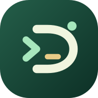
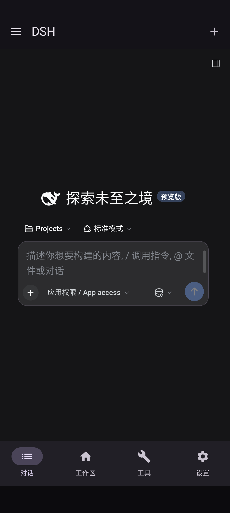
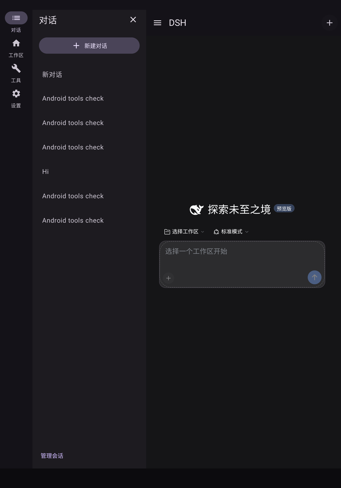
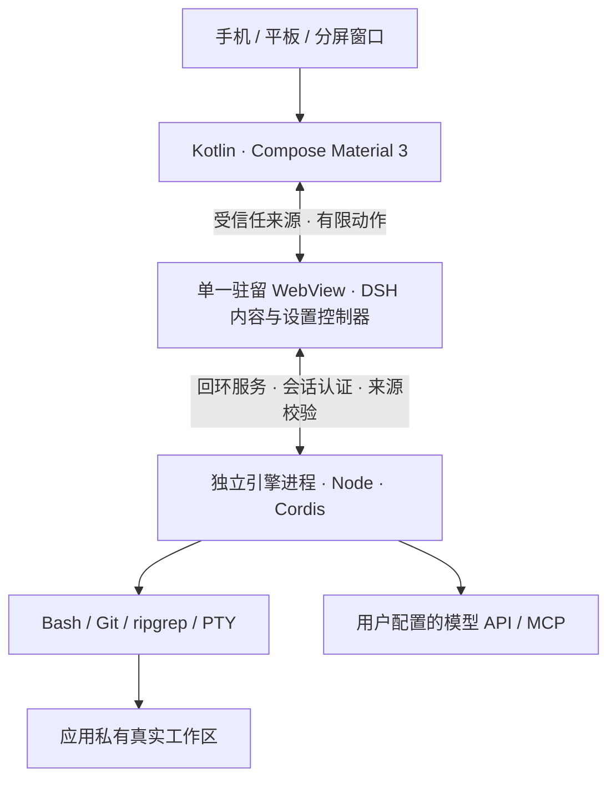

<p align="center"></p>

# DSH for Android

<p align="left">
  <a href="https://jimmy-xuzimo.github.io/DSH-for-Android/">项目网站</a> ·
  <a href="https://github.com/Jimmy-xuzimo/DSH-for-Android/releases/latest">下载安装</a> ·
  <a href="docs/ARCHITECTURE.md">技术原理</a> ·
  <a href="docs/VALIDATION.md">验证记录</a> ·
  <a href="docs/UPSTREAM_UPDATE.md">同步上游</a>
</p>

**把工作区，带在身边。** 在 Android 手机和平板本机运行 [DeepSeek Harness](https://github.com/deepseek-ai/deepseek-harness)，用原生 Material 3 交互管理对话、工作区和设置。

这是由 **Jimmy-xuzimo** 独立维护的 Android 移植，与 DeepSeek 官方 Android 产品无关。移植代码采用 MIT；上游、字体和各依赖保留自己的许可证。

## 这是什么

DSH 是带文件、Shell、终端、插件和 MCP 能力的 Agent 工作环境。本项目将它的运行时移植到 Android/Bionic，并用 Kotlin / Jetpack Compose 重做导航和设置。

- **独立 APK**：Android 10+，无需 root、Termux 或 Shizuku；提供 ARM64 和 x86_64 两种包。
- **本机工作区**：编辑器、Git、Bash、搜索和 PTY 使用同一个真实目录。
- **为不同窗口安排交互**：手机底部导航和左侧会话抽屉；宽屏展开可隐藏会话侧栏；设置支持单栏/双栏。
- **官方 Material 3 控件**：导航、设置、表单、开关、滑块、选择和弹窗采用 Google 组件。
- **统一外观**：系统动态色与五套静态配色、配套深浅色；一个字体选项统一应用，默认字体保持不变。
- **细致且可关闭的动画**：Material 组件动效、非线性页面和侧栏过渡；关闭后直接切换，尊重系统减少动画设置。
- **在线模型目录**：提供商地址预填为其默认端点，已有自定义地址保留；点击获取可用模型，选择后再保存。自定义提供商入口优先。
- **可追踪升级**：固定上游 SHA、源码校验值和依赖版本，补丁锚点变化时明确失败。

**本机运行的是 Agent 引擎和工具，模型通过用户配置的 API 推理。应用不附带离线大模型，模型费用由服务商收取。**

<p align="center"> </p>

## 安装

1. 在 [Releases](https://github.com/Jimmy-xuzimo/DSH-for-Android/releases/latest) 选择 ARM64 APK。x86_64 包主要供模拟器使用。
2. Android 最低 10（API 29）；系统 WebView 需为 Chromium 113 或更新版本。
3. 安装后等待首次校验和初始化，进入 **设置 → 模型**。
4. 填写自己的 API 密钥，确认 API 地址，获取并选择模型后保存。
5. 在工作区新建项目、克隆 HTTPS Git 仓库，或导入 ZIP。需要 Shell/终端时主动开启命令权限。

正式签名的预览版可按签名兼容性升级。旧调试签名 APK 不能直接覆盖安装，请先导出重要数据，再卸载旧版。本项目不自动迁移旧实现的会话。

应用私有数据随卸载删除。卸载前请导出项目；导出过滤常见凭据文件，但无法自动识别用户项目中的所有秘密，分享前仍需检查。

## 模型与提供商

模型设置通过 DSH 原有配置、校验和凭据服务保存，原生页面不是另一套模型配置。

| 场景 | 行为 |
| --- | --- |
| 内置提供商 | 读取适配器报告的默认 API 地址，显示实际有效值 |
| 已保存自定义地址 | 保留用户地址，查询当前地址，不擅自恢复官方地址 |
| DeepSeek 官方 | Messages 根为 `https://api.deepseek.com/anthropic`，模型目录请求同源 `/models` |
| OpenAI 兼容端点 | 使用对应协议的 `/models` 列表 |
| Anthropic Messages | 使用原生 `/v1/models` 列表 |
| 自定义服务 | 选择协议、输入地址和密钥，查询后选择模型；也可手动添加 |
| 不支持目录的协议或服务 | 显示失败/不支持原因，保留手动填写；不冒充获取成功 |

模型列表是主动查询结果，不把随 APK 附带的目录当作“在线刷新”。获取模型本身不发起一次生成请求。获取的新模型仍须符合 DSH 和提供商协议能力，不能保证任意未来模型均可使用。网络目录的披露范围和分页限制取决于协议适配器。

## 功能与边界

| 能力 | 当前路线 |
| --- | --- |
| 对话、流式回复、会话、文件编辑 | 保留 DSH 内容层与真实状态 |
| 原生导航与设置 | Kotlin + Compose Material 3 |
| Bash / Git / 搜索 / PTY | Android/Bionic 原生依赖随 APK 安装 |
| JavaScript 插件 | 支持与已打包运行时兼容的插件 |
| 网络 MCP | 使用 DSH 原有 MCP 配置与传输 |
| 本地 MCP | 使用随包解释器及依赖；需要额外原生程序的服务不能直接安装运行 |
| 桌面电脑/浏览器控制 | 默认禁用，不用空实现声称支持 |
| 完整 Linux 用户空间 | 不包含 Ubuntu/glibc，不能直接执行所有 Linux 二进制 |

这不是把全部 DSH 页面重写成原生 UI：对话、编辑器和终端仍由 WebView 呈现。第三方插件自带页面需要单独验证。

命令默认关闭。开启后，命令运行在应用权限内，可访问应用内多个工作区、使用中的凭据和网络；**这不是严格的单工作区隔离**。保留工具审批，不静默取消安全限制。前台服务显示通知并提供停止入口，系统仍可能终止后台进程。

## 技术原理



- 原生可执行程序和动态库放入 APK 的 `jniLibs`，从安装器管理的 `nativeLibraryDir` 启动或加载，避免从可写数据目录直接执行 ELF。
- JavaScript、资源及相对链接清单先解压到暂存目录，逐项校验，完成后原子切换；用户工作区独立保存。
- `EngineService` 管理启动、健康检查、停止和重启，正常重启复用本地来源并轮换令牌；端口冲突时拒绝启动。
- WebView 关闭任意文件访问，外部链接交给浏览器。Android 桥只允许当前回环来源的主框架。
- 原生设置控件通过有限语义 ID 调用 DSH 原有操作，保留上游的校验、版本冲突和持久化；密码不进入设置快照。
- 凭据由应用内服务保存；Android Keystore 包装持久加密材料，不将私钥放入仓库或 APK。

详见 [完整架构](docs/ARCHITECTURE.md)、[第三方声明](THIRD_PARTY_NOTICES.md) 和 [验证报告](docs/VALIDATION.md)。

## 与其他移植路线的取舍

以 [DSHA](https://github.com/DSH-APP/DSHA) 的公开说明为参考：它采用完整 Ubuntu 用户空间和 proroot 路线，提供另一种 Android 上运行 DSH 的方式。这里比较架构，不进行未经测试的速度或稳定性排名。

| 维度 | 本项目 Android/Bionic 路线 | Ubuntu / proroot 路线 |
| --- | --- | --- |
| 运行环境 | 为 Android 构建的 Node 与随包工具 | Linux 用户空间中的运行时和工具 |
| 首次准备 | 校验并初始化 APK 内置资源 | 取决于发行包的 rootfs 准备流程 |
| 原生扩展 | 必须与 Bionic、ABI 和已打包依赖兼容 | 通常更贴近 Linux 工具生态，仍需考虑运行层限制 |
| 导航与设置 | Google Compose Material 3 原生层 | 各项目自己的原生/网页适配方案 |
| 上游更新 | 固定 SHA、追踪补丁、重建验证 | 取决于各项目的同步和部署策略 |

本项目的重点是原生交互、安装路径与可追踪维护；完整 Linux 环境有其兼容性优势。感谢不同路线的开源探索。

## 源码构建

原生交叉编译在 Linux 上进行，Windows 可用 WSL。固定版本见锁文件和 Gradle 配置。

| 工具 | 版本 |
| --- | --- |
| Node / pnpm | 24.21.0 / 11.28.5 |
| Rust | 1.85.1，安装两个 Android target |
| NDK | 28.2.13676358 |
| JDK / Gradle | 25.0.3 / Wrapper 固定版本 |
| Android SDK | compile 37.2 / target 36 / min 29 |
| Build Tools | 36.0.0 |

```sh
npm install --global pnpm@11.28.5
rustup toolchain install 1.85.1 --profile minimal
rustup target add --toolchain 1.85.1 aarch64-linux-android x86_64-linux-android
export ANDROID_NDK_HOME=/path/to/android-ndk-r28c
bash scripts/build-runtime.sh
./gradlew :app:testX64DebugUnitTest :app:lintX64Debug \
  :app:assembleX64Debug :app:assembleArm64Debug :app:assembleX64DebugAndroidTest
./gradlew :app:connectedX64DebugAndroidTest
```

正式包需要 `DSH_KEYSTORE`、`DSH_STORE_PASSWORD`、`DSH_KEY_ALIAS`、`DSH_KEY_PASSWORD`。签名配置缺失时失败，不回退调试签名。签名私钥须独立备份。

`sources.lock.json` 固定原生依赖下载地址和 SHA-256，`upstream.lock.json` 固定 DSH 提交。Release 附源码、GPL 对应源码、APK 校验值和验证报告。原生 ELF 与 APK ZIP 对齐检查不等于完成真实 16 KB 设备验证。

Material 配色可用 `npm ci && node scripts/generate-colors.mjs` 重新生成；使用 Google Material Color Utilities 0.3.0。Noto Sans SC 原始字体、固定来源和 OFL 授权记录见 [字体说明](licenses/fonts/README.md)。

## 更新与维护

当前上游为 `22ddee3792402c3e70ec5f86a63c3e3e895a2f60`，DSH `0.2.1-rc.3`。版本升级按 [上游升级流程](docs/UPSTREAM_UPDATE.md) 准备候选、校验补丁、构建并验证；不能直接替换一个下载地址后发布。

Android 更新通过签名 APK 分发；不向应用可写目录下载 ELF 执行。`.github/workflows/android.yml` 提供干净环境构建与模拟器测试，`release.yml` 使用正式签名配置，`pages.yml` 部署静态项目网站。配置工作流不等于云端已验证，具体运行状态以 GitHub Actions 和 Release 报告为准。

报告问题请附 Android / WebView 版本、设备 ABI、窗口尺寸、操作步骤和脱敏诊断。不要公开 API 密钥或含凭据的项目归档。

## 感谢与许可证

首先感谢 [DeepSeek Harness](https://github.com/deepseek-ai/deepseek-harness) 团队及其全部贡献者。本项目依赖其 Agent、插件、会话与工具架构，不把上游成果归为移植作者原创。

感谢 AndroidX / Jetpack Compose、Node.js、GNU Bash、Git、ripgrep、curl、OpenSSL、node-pty、Google Material Color Utilities、Noto 字体项目，以及所有间接依赖的维护者。

移植代码为 [MIT](LICENSE)。上游和复用依赖的作者、版权与许可证保留在 [THIRD_PARTY_NOTICES.md](THIRD_PARTY_NOTICES.md) 与 `licenses/`，包含 GPL 组件的对应源码随 Release 提供。GitHub 的贡献者统计不替代这些权利归属。
